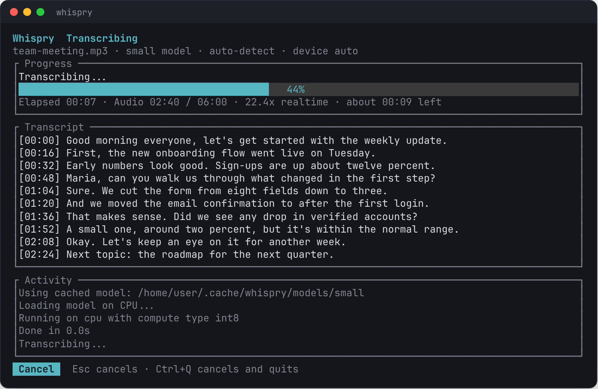
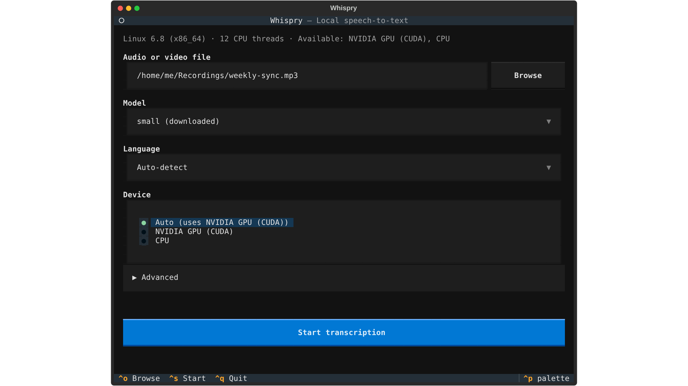
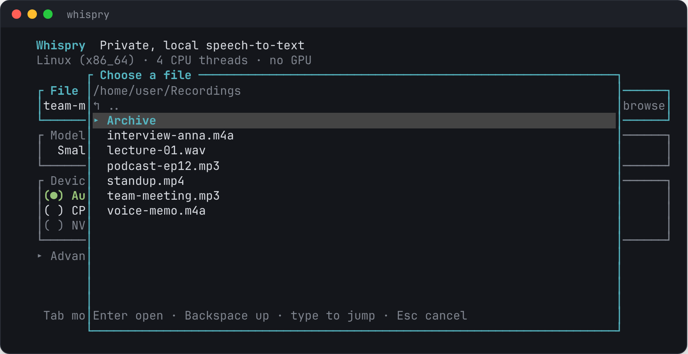
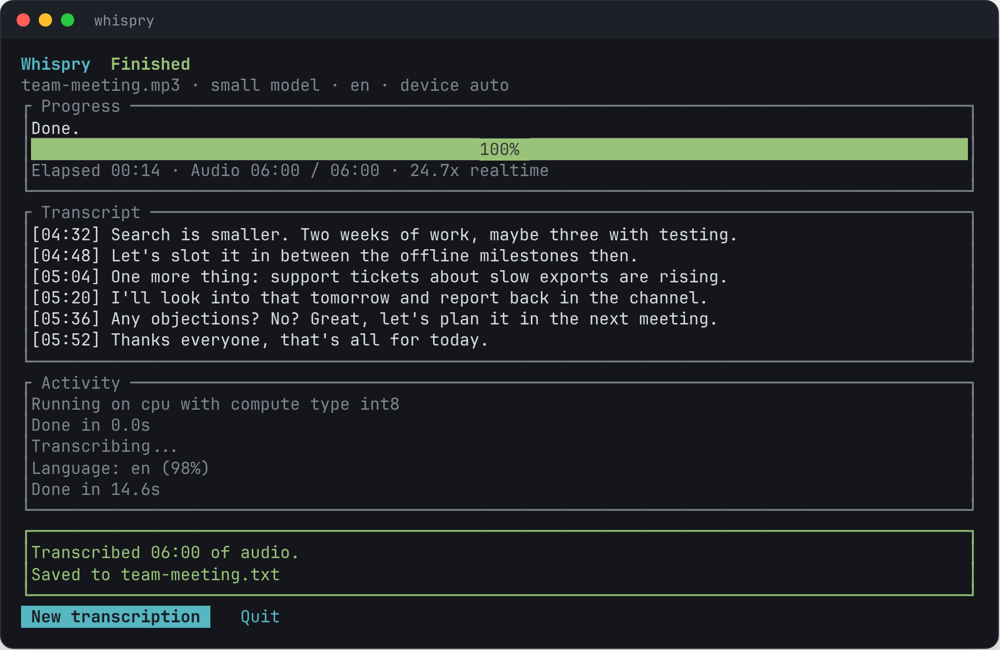
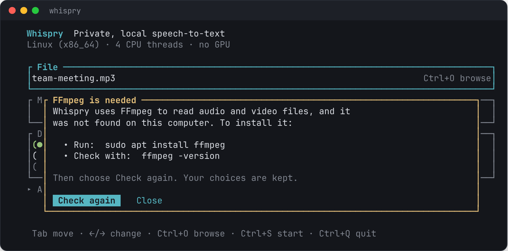

<h1 align="center">Whispry</h1>

<p align="center">
  <b>Turn recordings into text, right on your own computer.</b><br>
  No uploads, no accounts, no subscriptions. Just your audio and your machine.
</p>

<p align="center">
  
</p>

Whispry is a friendly terminal app for speech-to-text. Point it at a
meeting, lecture, interview, or voice memo, and watch the transcript
appear line by line. It runs on Linux and Windows, uses your NVIDIA GPU
when you have one, and works fine on a plain laptop CPU when you don't.

Under the hood it uses [faster-whisper](https://github.com/SYSTRAN/faster-whisper)
and CTranslate2, OpenAI's Whisper models made fast. The app itself is
written in Rust, so it starts instantly and stays light.

## Quick start

1. Download the archive for your system from the
   [Releases page](https://github.com/seyallius/whispry/releases) and unpack it.
2. Run the one-time setup. It needs Python 3.10 or newer, and nothing else:

   ```bash
   cd whispry-0.3.0-linux-x86_64
   python3 setup.py          # Windows: py setup.py
   ```

3. Start Whispry:

   ```bash
   ./whispry                 # Windows: .\whispry.exe
   ```

Setup figures out whether you have an NVIDIA GPU, installs only what your
machine needs into a private `.venv` folder next to the program, and checks
whether FFmpeg is installed. It asks nothing and installs nothing
system-wide.

## A quick tour

**Pick what to transcribe.** Choose a file (type a path, paste one, or
browse), a model, the language, and where to run it. Whispry checks your
machine first: if there's no usable GPU, that option is greyed out and tells
you why.

<p align="center">
  
</p>

**Browse for a file.** Press `Ctrl+O` to look around. Folders come first,
then your audio and video files.

<p align="center">
  
</p>

**Watch it work.** The transcript fills in as Whispry listens, with
progress, speed, and an estimate of the time left. Changed your mind?
Press `Esc`; anything already transcribed is kept.

**Get your text.** A timestamped `.txt` file lands right next to your
recording.

<p align="center">
  
</p>

**Missing FFmpeg? Whispry tells you what to do.** It shows the install
steps for your system and picks up where you left off once it's installed.

<p align="center">
  
</p>

_Screenshots show demo content._

## Features

- **Private by design:** your audio never leaves your computer
- **CPU or GPU:** runs anywhere, uses an NVIDIA GPU automatically when
  available, and falls back to the CPU if the GPU has trouble
- **Handles long recordings:** audio is processed a few minutes at a time,
  so a three-hour recording needs no more memory for audio than a
  three-minute one
- **Cuts at pauses, not mid-word:** each chunk ends in a quiet moment
- **Persian and English**, or let Whispry detect the language
- **Small and Medium models**, downloaded once and then used offline
- **Terminal UI for people, command line for scripts**, both powered by the
  same engine
- **Timestamped UTF-8 text** you can search, edit, or share

## Requirements

- Linux or Windows (64-bit)
- Python 3.10 or newer, for the one-time setup and the transcription worker
- FFmpeg (see [below](#ffmpeg))
- Optional: an NVIDIA GPU with a recent driver (CUDA 12)
- Internet access for setup and for the first download of each model

## Installation

The [quick start](#quick-start) covers most people. In more detail:

`setup.py` creates a `.venv` folder next to the program and installs the
transcription worker into it. It adds the NVIDIA CUDA libraries only when it
finds an NVIDIA GPU, about 1.3 GB, and skips that download when the CUDA
libraries are already installed on your computer. Pass `--gpu` or `--cpu` to choose yourself. Whispry
finds that folder on its own; to use another Python, set `WHISPRY_PYTHON` to
its path.

### Building from source

You need [Rust](https://rustup.rs) and Python 3.10 or newer.

```bash
git clone https://github.com/seyallius/whispry.git
cd whispry
cargo build --release
python3 scripts/setup.py          # Windows: py scripts\setup.py
./target/release/whispry          # run it from the checkout folder
```

Run the program from inside the checkout so it finds the `.venv` there, or
set `WHISPRY_PYTHON` to `.venv/bin/python` (Windows:
`.venv\Scripts\python.exe`).

### FFmpeg

Whispry uses FFmpeg to read audio and video files. If it isn't installed,
the app shows these steps for your system, and `whispry ffmpeg` prints them
too:

- **Windows:** `winget install --id Gyan.FFmpeg -e`
- **Ubuntu or Debian:** `sudo apt install ffmpeg`
- **Fedora:** `sudo dnf install ffmpeg-free`
- **Arch:** `sudo pacman -S ffmpeg`

Open a new terminal afterwards so the change to `PATH` is picked up.

## Usage

Run `whispry` with no arguments to open the terminal UI. Choose a file,
model, language, and device, then press **Start**.

| Key | What it does |
|---|---|
| `Tab` / `Shift+Tab`, `↑` / `↓` | Move between fields |
| `←` / `→` | Change a choice |
| `Ctrl+O` | Browse for a file |
| `Ctrl+S` | Start transcribing |
| `Esc` | Cancel a running job (text so far is kept) |
| `Ctrl+Q` | Quit (cancels a running job first) |

You can also paste a path, quotes and all, straight into the file field.

### Command line

```bash
whispry transcribe recording.mp3
whispry transcribe recording.mp3 --language fa --model medium
whispry transcribe recording.mp4 --device cpu --output notes.txt
whispry devices          # OS, CPU and GPU, FFmpeg, and the worker in use
whispry ffmpeg           # check for FFmpeg, or show how to install it
whispry download medium  # pre-download a model for offline use
```

`--device` accepts `auto` (default: GPU if available, else CPU), `cpu`, or
`cuda`. `--chunk-minutes` sets how much audio is processed at once (default
10; lower uses less RAM). Press `Ctrl+C` to stop; the text so far stays in
the output file and Whispry exits with code 130.

The transcription is written to a `.txt` file beside the input unless
`--output` is given.

## Models

Whispry uses the Small model by default. Each model is downloaded from
Hugging Face on first use and cached in:

- Linux: `~/.cache/whispry/models`
- Windows: `%LOCALAPPDATA%\whispry\models`

Set `WHISPRY_MODEL_DIR` to use another folder. After a model is cached,
transcription works offline.

## How it works

1. Detect the OS, whether a usable NVIDIA GPU is present, and FFmpeg.
2. Find the selected model, or download it, and have the worker load it on
   the chosen device. The worker picks the best compute type the device
   supports.
3. Stream the decoded audio from FFmpeg in small blocks.
4. Group blocks into windows of about 10 minutes, ending each window in the
   longest pause near its end, so no word is cut in half.
5. Send each window to the speech engine in pieces of at most 30 seconds,
   cut at pauses. The language is detected once and then kept.
6. Write each timestamped line to the output file as soon as it is ready.

The code is split into three parts:

- `crates/whispry-core/`: all the logic (detection, FFmpeg, streaming,
  chunking, models, the job runner). It never prints; it reports progress
  through typed events and can be cancelled from another thread.
- `crates/whispry/`: the terminal UI and the command line. They only turn
  user input into a job and draw the events it emits.
- `worker/`: a small Python program that runs faster-whisper. Whispry starts
  it as a separate process and talks to it with one JSON message per line,
  described in [`worker/PROTOCOL.md`](worker/PROTOCOL.md). A crash in GPU code
  can't take the interface down, and cancelling is just a message.

## Development

You need [Rust](https://rustup.rs), Python 3.10 or newer, and
[just](https://github.com/casey/just) for the recipes. Run `just` to list
them.

```bash
just setup   # create .venv with the worker and its test tools
just test    # Rust tests, worker tests and script tests
just lint    # formatting and clippy
just run     # run Whispry from the checkout
just check   # show detected devices, FFmpeg and the worker
```

Tests that need FFmpeg or Python are skipped when those are missing. Set
`WHISPRY_TEST_STRICT=1` to make them fail instead, as CI does on Linux and
Windows.

To publish a release, push a tag such as `v0.3.0` (it must match the
version in `Cargo.toml`). GitHub Actions builds the Linux and Windows
archives and attaches them to a new release.

## Limitations

- GPU acceleration requires an NVIDIA GPU with CUDA 12 support. Apple
  Silicon and AMD GPUs are not supported.
- The CPU is much slower than a GPU, especially with the Medium model.
- Progress is estimated from completed segments.
- The Small model may be less accurate for difficult Persian audio.
- Linux and Windows on 64-bit Intel and AMD processors are supported.

## Privacy

Audio processing happens locally.

Model downloads contact Hugging Face when a model is missing, and setup
contacts the Python package index. No audio file is uploaded by the
application.

## License

See LICENSE.
